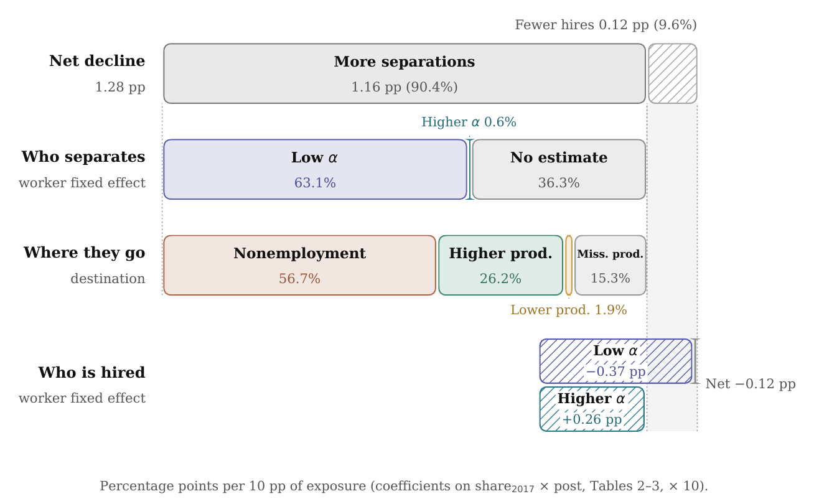
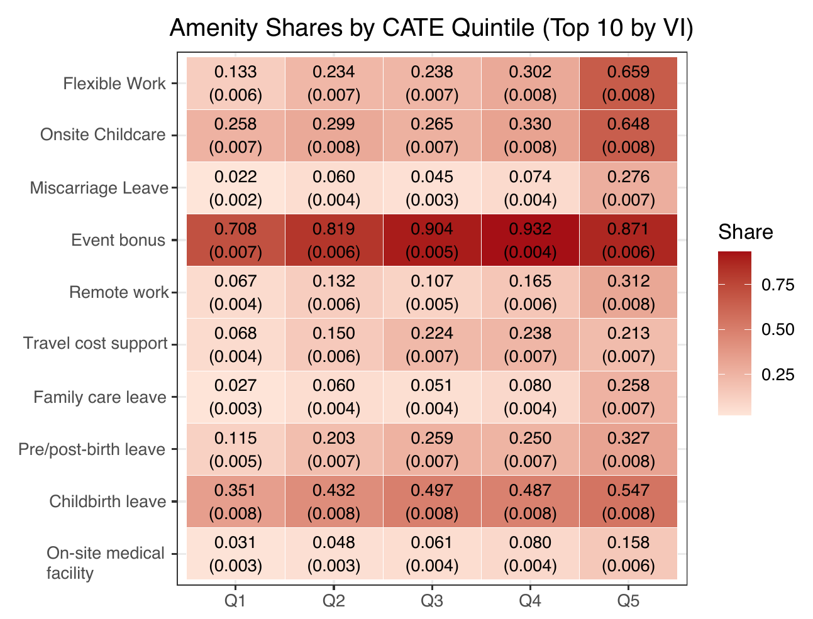

My research is in **labor economics** and **firm dynamics**. I study how workers reallocate across firms in response to labor-market policies, and how differences across firms—in productivity, pay, and workplace conditions—shape workers' careers. My work uses matched employer–employee administrative data from Statistics Korea.

---

## Working Papers

  

    
    
Decomposition of the employment decline per 10 pp of minimum-wage exposure: who loses the job, where they go, and who is hired (Figure 4)

  

  

    <h3 class="research-title">Employment and Reallocation after a Minimum Wage Shock</h3>
    

      Using employer–employee matched data from Statistics Korea (2015–2020) and firm-level exposure to Korea's 29% minimum wage increase of 2018–2019, I show that employment falls at more exposed firms, mostly through separations rather than hiring. Low-quality workers account for 63% of these separations. More than half of separated workers remain in nonemployment, while 26% move up the job ladder to more productive firms and only 2% move down. On the hiring margin, firms substitute high-quality for low-quality workers.
    

    <ul class="research-links">
      <li><a href="/assets/files/MW_Paper.pdf">Draft</a>, November 2026 (writing sample)</li>
      <li><a href="/assets/files/MW_Slides.pdf">Slides</a>, November 2026</li>
      <li>Presented at the WEAI 18th International Conference, April 2026</li>
    </ul>
  

---

## Work in Progress

  

    
    
Amenity prevalence across quintiles of causal-forest CATEs for post-birth employment: flexible work and onsite childcare rise sharply where penalties are smallest (Figure 3)

  

  

    <h3 class="research-title">Family-Friendly Firms and the Motherhood Penalty</h3>
    
with Tammy Lee and Jungmin Lee

    

      Do workplace amenities mitigate the motherhood penalty? Linking matched employer–employee administrative data with hand-collected information on workplace amenities for Korean firms, we document substantial heterogeneity in motherhood penalties across companies. Women initially employed at family-friendly firms are more likely to remain in the labor market after childbirth, while those at less supportive firms tend to exit rather than switch to more accommodating employers. Using a causal forest, we show that flexible work arrangements, onsite childcare, and remote work options are the amenities most strongly associated with smaller post-birth declines in employment and earnings. We are now decomposing cross-firm dispersion in motherhood penalties into mother composition, firm characteristics, and reported benefits.
    

    <ul class="research-links">
      <li>Draft coming soon!</li>
      <li><a href="/assets/files/Amenity_Slides.pdf">Slides</a> on the decomposition, October 2026</li>
    </ul>
  

